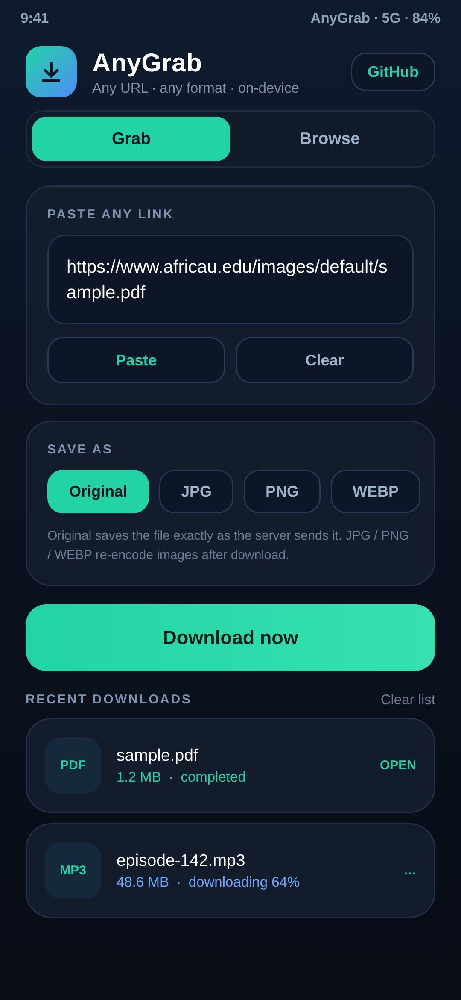
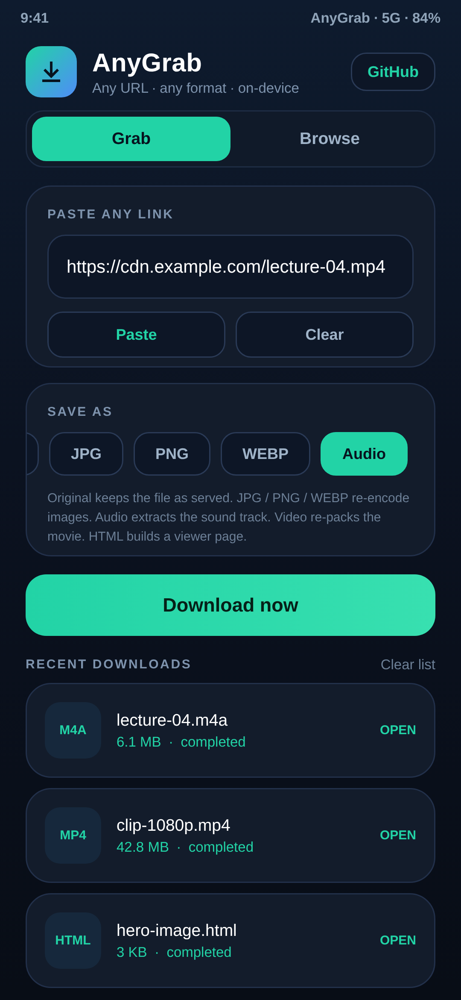
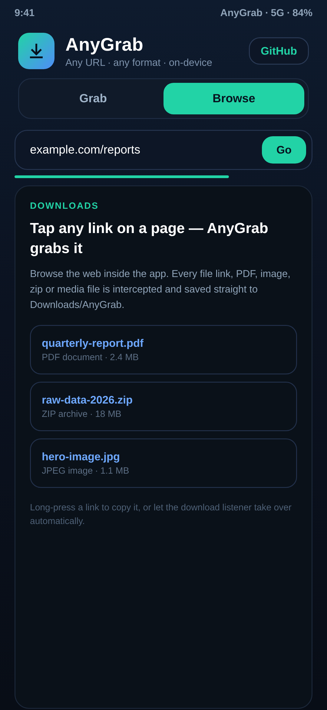

<div align="center">

<a href="https://github.com/technicalnihilist-lgtm/anygrab/stargazers"></a>&nbsp;<a href="https://github.com/technicalnihilist-lgtm/anygrab/network/members"></a>

<h3>AnyGrab - paste any URL, download any format</h3>

  

<a href="https://github.com/technicalnihilist-lgtm/anygrab/releases/latest"></a>

<b>Support the work</b>

  

<sub>Donations aren't live yet — Paytm, UPI, PayPal and Buy&nbsp;Me&nbsp;a&nbsp;Coffee all show <b>coming soon</b>. Until then, a ⭐ star is the best support.</sub>

<a href="https://github.com/technicalnihilist-lgtm/anygrab/releases/latest"></a>  <a href="https://github.com/technicalnihilist-lgtm/anygrab/releases"></a>

<h4>Get it from</h4>

<a href="https://github.com/technicalnihilist-lgtm/anygrab/releases"></a> <a href="https://github.com/technicalnihilist-lgtm/anygrab/archive/refs/heads/main.zip"></a>

</div>

---

---

<div align="center">


## Screenshots

| Grab | Any format | Browse + save page |
|:---:|:---:|:---:|
|  |  |  |
| Paste a link, hit download | Original / JPG / PNG / WEBP / Audio / Video / HTML | Tap any file link, or save the whole page |

## What's new in 1.2.0 — the "always an HTML file" bug

Two real bugs, both fixed:

1. **A page link used to save the page itself.** Paste a normal web page URL with *Video* or *Audio* selected and AnyGrab downloaded the page's HTML — the conversion then had nothing to work on, so you were left with an `.html` file. Now, when the link is a web page, the app reads the page, finds the real media behind it and downloads **that** instead. If the page hides no media, it says so instead of saving junk.
2. **The video remux was broken.** `MediaExtractor.selectTrack()` was being called inside the read loop, and it resets that track to its first sample. Video conversion could stall or produce a bad file. Both tracks are now selected once, and samples are routed with `getSampleTrackIndex()`.

Also new:

- **HLS support.** `.m3u8` streams are downloaded properly: master playlist → best variant (or the audio rendition when you pick Audio) → every segment stitched, then remuxed to `.mp4` / `.m4a`. Encrypted (DRM) playlists are refused with a clear message.
- **Media sniffing from pages** covers `og:video`, `og:audio`, `twitter:player:stream`, `<video>` / `<audio>` / `<source>` tags, JSON-LD `contentUrl`, and raw media URLs inside scripts — including slash-escaped ones (`https:\/\/…`).
- **Retry works.** A failed download now retries its own URL instead of opening the repo page.

## What it does

- **Any URL in.** Direct files, image CDN links, zips, APKs, podcasts, video files — and normal web pages, where it digs out the media.
- **Smarter than a browser.** A ranged request, redirect following, `Content-Disposition` / `Content-Type` parsing, and a sensible file name even when the URL has no extension (`…/download?id=42`).
- **Seven output formats.** Original, JPG, PNG, WEBP, Audio, Video, HTML — all on-device.
- **Browse mode.** Built-in WebView with a download listener; any file link you tap is grabbed. **Save this page as HTML** captures the current page.
- **Share-to-grab.** Share a link from any app and AnyGrab prefills it.
- **Real downloads.** System `DownloadManager`: background, resumable, notification on completion, saved to `Downloads/AnyGrab/`.

## Output formats

| Choice | What you get | How |
|---|---|---|
| **Original** | The file exactly as the server sends it | `DownloadManager` |
| **JPG / PNG / WEBP** | Re-encoded image | `BitmapFactory` + `Bitmap.compress` |
| **Audio** | `.m4a` (AAC) or `.webm` (Opus/Vorbis) | `MediaExtractor` → `MediaMuxer`, no re-encode |
| **Video** | `.mp4` or `.webm` | `MediaExtractor` → `MediaMuxer`, lossless remux |
| **HTML** | A viewer page next to the file | Generated locally, zero network |

Audio and Video work on **direct media links, page links and `.m3u8` streams**.

## Install

1. Download `AnyGrab-1.2.0.apk` from the [releases page](https://github.com/technicalnihilist-lgtm/anygrab/releases/latest).
2. Allow *Install unknown apps* when prompted.
3. Install and open. Files land in `Downloads/AnyGrab/`.

Upgrading? Install straight over the old version — same signing key, your downloads stay.

**Requires Android 5.0 (API 21) or newer.** Targets Android 15 (API 35).

## How it works

| Piece | Job |
|---|---|
| `MainActivity` | Tabs, URL field, format chips, download list, browse WebView, page capture |
| `Net` | Ranged GET probe → redirects, `Content-Disposition` / `Content-Type`, name and size |
| `PageGrab` | Finds the media URL inside a web page (Open Graph, media tags, JSON-LD, raw URLs) |
| `HlsDownloader` | Playlist parsing, variant choice, segment stitching |
| `MediaConvert` | Audio extraction and video remux via `MediaExtractor` + `MediaMuxer` |
| `ImageConvert` + `Api29` | Image re-encode, published through MediaStore on Android 10+ |
| `HtmlWrap` | Viewer pages and browsed-page capture |
| `DownloadsAdapter` | Live list with progress, status and error reasons |

Framework-only — no AndroidX, no Gradle, no third-party libraries. ~78 KB APK.

## Build it yourself

JDK 17, Android SDK platform 35, build-tools 34.0.0.

```bash
export ANDROID_SDK_ROOT=/path/to/android-sdk
./build.sh
```

`build.sh` drives the real toolchain: `aapt2 compile` → `aapt2 link` → `javac` → `d8` → `zipalign` → `apksigner`.

## Tests

`test/TestAll.java` runs the Android-free parts on a desktop JVM against a local HTTP server — playlist parsing, variant selection, segment stitching, DRM refusal, and page media sniffing (10 checks):

```bash
cd test && mkdir -p out
javac -d out src/android/content/Context.java \
  ../app/src/main/java/com/anygrab/downloader/Net.java \
  ../app/src/main/java/com/anygrab/downloader/HlsDownloader.java \
  ../app/src/main/java/com/anygrab/downloader/PageGrab.java TestAll.java
java -cp out TestAll
```

## Known limits (honest ones)

- **Player-only and DRM pages still cannot be saved.** YouTube and similar sites do not hand out a file to anyone without their permission flow; that needs a server-side extractor, not an on-device app. The app now tells you clearly instead of leaving an HTML file behind.
- **Audio output is `.m4a` / `.webm`, not `.mp3`** — Android ships no MP3 encoder.
- **Remux, not transcode.** Video keeps its original codec (H.264/HEVC → MP4, VP8/VP9/AV1 → WebM). Incompatible pairs are reported.
- **Live HLS** is captured from the point you press download until you stop it; it is not a continuous recorder.
- Page capture saves the DOM as it stands, so heavily scripted pages may not look identical offline.

## License

MIT — see [LICENSE](LICENSE).

---

## 🌍 Languages

<sub>Donations are <b>coming soon</b> in every language below — nothing to pay today, nothing to click.</sub>

<div align="center">

<sub><b>हिन्दी · বাংলা · मराठी · తెలుగు · தமிழ் · ગુજરાતી · ಕನ್ನಡ · മലയാളം · ਪੰਜਾਬੀ · ଓଡ଼ିଆ · অসমীয়া · اردو</b></sub>

</div>

<details>
<summary><b>🌍 Open the same message in 53 languages</b></summary>

**🇮🇳 Indian languages**

- **हिन्दी** (Hindi) — ☕ जल्द ही आ रहा है। · ⭐ अगर आपको यह ऐप और हमारा काम पसंद है, तो कृपया रिपॉजिटरी को स्टार दें और हमें फॉलो करें।
- **বাংলা** (Bengali) — ☕ খুব শিগগিরই আসছে। · ⭐ যদি আপনার এই অ্যাপ এবং আমাদের কাজ ভালো লাগে, তবে অনুগ্রহ করে রিপোজিটরিটিকে একটি স্টার দিন এবং আমাদের ফলো করুন।
- **मराठी** (Marathi) — ☕ लवकरच येत आहे. · ⭐ जर तुम्हाला हे ॲप आणि आमचं काम आवडलं असेल, तर कृपया रिपॉझिटरीला स्टार द्या आणि आम्हाला फॉलो करा.
- **తెలుగు** (Telugu) — ☕ త్వరలో రాబోతోంది. · ⭐ మీకు ఈ యాప్, మా పని నచ్చితే, దయచేసి రిపోజిటరీకి ఒక స్టార్ ఇచ్చి మమ్మల్ని ఫాలో అవ్వండి.
- **தமிழ்** (Tamil) — ☕ விரைவில் வருகிறது. · ⭐ உங்களுக்கு இந்த ஆப்பும் எங்க வேலையும் பிடிச்சிருந்தா, தயவுசெஞ்சு இந்த ரெபாசிட்டரிக்கு ஒரு ஸ்டார்…
- **ગુજરાતી** (Gujarati) — ☕ ટૂંક સમયમાં આવી રહ્યું છે. · ⭐ જો તમને આ એપ અને અમારું કામ ગમતું હોય, તો પ્લીઝ રિપોઝિટરીને સ્ટાર આપો અને અમને ફોલો કરો.
- **ಕನ್ನಡ** (Kannada) — ☕ ಶೀಘ್ರದಲ್ಲೇ ಬರುತ್ತಿದೆ. · ⭐ ನಿಮಗೆ ಈ ಆ್ಯಪ್ ಮತ್ತು ನಮ್ಮ ಕೆಲಸ ಇಷ್ಟವಾದರೆ, ದಯವಿಟ್ಟು ರೆಪೊಸಿಟರಿಗೆ ಸ್ಟಾರ್ ಕೊಡಿ ಮತ್ತು ನಮ್ಮನ್ನು ಫಾಲೋ ಮಾಡಿ.
- **മലയാളം** (Malayalam) — ☕ ഉടൻ വരുന്നു. · ⭐ നിങ്ങൾക്ക് ഈ ആപ്പും ഞങ്ങളുടെ പ്രവർത്തനവും ഇഷ്ടപ്പെട്ടെങ്കിൽ, ദയവായി റെപ്പോസിറ്ററിക്ക് ഒരു സ്റ്റാർ…
- **ਪੰਜਾਬੀ** (Punjabi) — ☕ ਜਲਦੀ ਆ ਰਿਹਾ ਹੈ। · ⭐ ਜੇ ਤੁਹਾਨੂੰ ਇਹ ਐਪ ਅਤੇ ਸਾਡਾ ਕੰਮ ਪਸੰਦ ਹੈ, ਤਾਂ ਕਿਰਪਾ ਕਰਕੇ ਰਿਪੋਜ਼ਟਰੀ ਨੂੰ ਸਟਾਰ ਦਿਓ ਅਤੇ ਸਾਨੂੰ ਫਾਲੋ ਕਰੋ।
- **ଓଡ଼ିଆ** (Odia) — ☕ ଖୁବ୍ ଶୀଘ୍ର ଆସୁଛି। · ⭐ ଯଦି ଆପଣଙ୍କୁ ଏହି ଆପ୍ ଏବଂ ଆମର କାମ ଭଲ ଲାଗୁଛି, ତେବେ ଦୟାକରି ରିପୋଜିଟୋରୀକୁ ଗୋଟିଏ ଷ୍ଟାର୍ ଦିଅନ୍ତୁ ଏବଂ ଆମକୁ ଫଲୋ କରନ୍ତୁ।
- **অসমীয়া** (Assamese) — ☕ অতি সোনকালেই আহি আছে। · ⭐ যদি আপুনি এই এপটো আৰু আমাৰ কাম ভাল পায়, তেন্তে অনুগ্ৰহ কৰি ৰিপজিটৰীটোক এটা ষ্টাৰ দিয়ক আৰু আমাক ফ'ল' কৰক।
- **اردو** (Urdu) — ☕ جلد آرہا ہے۔ · ⭐ اگر آپ کو یہ ایپ اور ہمارا کام پسند آئے تو براہ کرم ریپازٹری کو سٹار دیں اور ہمیں فالو کریں۔
- **संस्कृतम्** (Sanskrit) — ☕ शीघ्रमेव आगच्छति।
- **मैथिली** (Maithili) — ☕ जल्दिये आबि रहल अछि।
- **कोंकणी** (Konkani) — ☕ रोखडेंच येता.
- **کٲشُر** (Kashmiri) — ☕ جَلدی یِوان چھُ۔
- **سنڌي** (Sindhi) — ☕ जल्द अची रह्यो आहे।
- **डोगरी** (Dogri) — ☕ जल्दी आ करदा ऐ।
- **ꯃꯤꯇꯩ ꯂꯣꯟ** (Manipuri) — ☕ ꯑꯊꯨꯕꯥ ꯃꯇꯝꯗꯥ ꯂꯥꯛꯀꯅꯤ꯫
- **बर’** (Bodo) — ☕ थाबैनो फैगोन।
- **ᱥᱟᱱᱛᱟᱲᱤ** (Santali) — ☕ ᱞᱚᱜᱚᱱ ᱦᱤᱡᱩᱜ ᱠᱟᱱᱟ᱾
- **नेपाली** (Nepali) — ☕ छिट्टै आउँदैछ। · ⭐ यदि तपाईंलाई यो एप र हाम्रो काम मन पर्‍यो भने, कृपया रिपोजिटरीलाई स्टार दिनुहोस् र हामीलाई फलो गर्नुहोस्।

**🌍 World languages**

- **العربية** (Arabic) — ☕ قريبًا. · ⭐ إذا أعجبك هذا التطبيق وعملنا، فيرجى منح المستودع نجمة ومتابعتنا.
- **简体中文** (Chinese (Simplified)) — ☕ 即将推出。
- **繁體中文** (Chinese (Traditional)) — ☕ 即將推出。
- **Čeština** (Czech) — ☕ Již brzy.
- **Dansk** (Danish) — ☕ Kommer snart.
- **Nederlands** (Dutch) — ☕ Binnenkort beschikbaar. · ⭐ Vind je deze app en ons werk leuk?
- **Filipino** (Filipino) — ☕ Malapit na.
- **Suomi** (Finnish) — ☕ Tulossa pian.
- **Français** (French) — ☕ Bientôt disponible. · ⭐ Si cette application et notre travail vous plaisent, mettez une étoile au dépôt et suivez-nous.
- **Deutsch** (German) — ☕ Bald verfügbar. · ⭐ Wenn dir diese App und unsere Arbeit gefallen, gib dem Repository einen Stern und folge uns.
- **Ελληνικά** (Greek) — ☕ Έρχεται σύντομα.
- **עברית** (Hebrew) — ☕ בקרוב.
- **Magyar** (Hungarian) — ☕ Hamarosan.
- **Bahasa Indonesia** (Indonesian) — ☕ Segera hadir. · ⭐ Jika kamu suka aplikasi ini dan karya kami, beri bintang pada repositori ini dan ikuti kami.
- **Italiano** (Italian) — ☕ In arrivo.
- **日本語** (Japanese) — ☕ 近日公開。 · ⭐ このアプリと私たちの仕事が気に入ったら、リポジトリにスターを付けてフォローしてください。
- **한국어** (Korean) — ☕ 곧 공개됩니다. · ⭐ 이 앱과 저희 작업이 마음에 드신다면 저장소에 스타를 눌러 주시고 팔로우해 주세요.
- **Bahasa Melayu** (Malay) — ☕ Akan datang.
- **Norsk** (Norwegian) — ☕ Kommer snart.
- **فارسی** (Persian) — ☕ به‌زودی.
- **Polski** (Polish) — ☕ Wkrótce. · ⭐ Jeśli podoba Ci się ta aplikacja i nasza praca, daj repozytorium gwiazdkę i obserwuj nas.
- **Português** (Portuguese) — ☕ Em breve.
- **Română** (Romanian) — ☕ În curând.
- **Русский** (Russian) — ☕ Скоро. · ⭐ Если вам нравится это приложение и наша работа, поставьте звёздочку репозиторию и подпишитесь на нас.
- **Español** (Spanish) — ☕ Muy pronto. · ⭐ Si te gusta esta app y nuestro trabajo, dale una estrella al repositorio y síguenos.
- **Kiswahili** (Swahili) — ☕ Inakuja hivi karibuni.
- **Svenska** (Swedish) — ☕ Kommer snart.
- **ไทย** (Thai) — ☕ เร็ว ๆ นี้
- **Türkçe** (Turkish) — ☕ Çok yakında.
- **Українська** (Ukrainian) — ☕ Незабаром.
- **Tiếng Việt** (Vietnamese) — ☕ Sắp ra mắt. · ⭐ Nếu bạn thích ứng dụng này và công việc của chúng tôi, hãy tặng kho lưu trữ một ngôi sao và theo…

</details>

