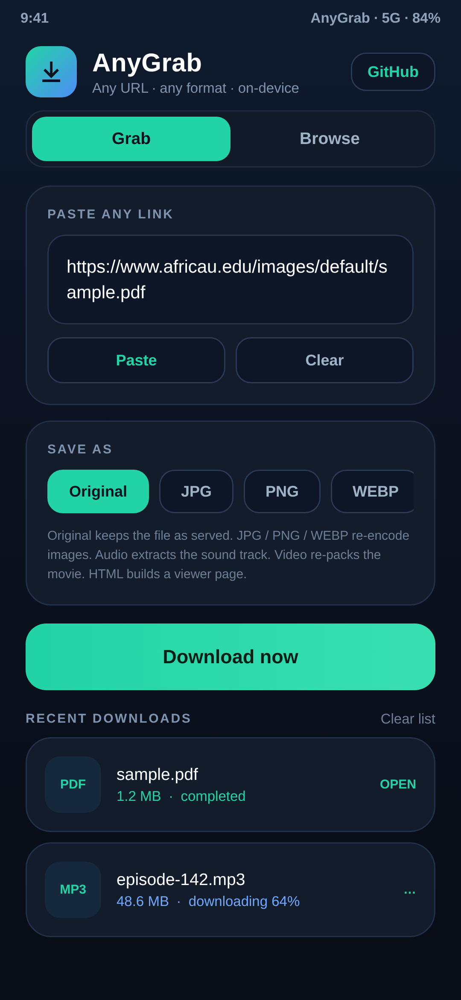
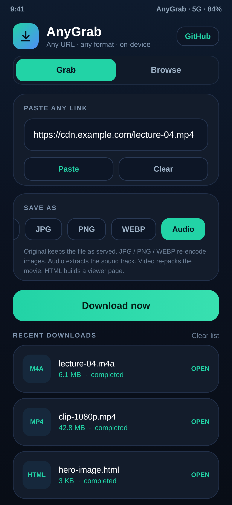
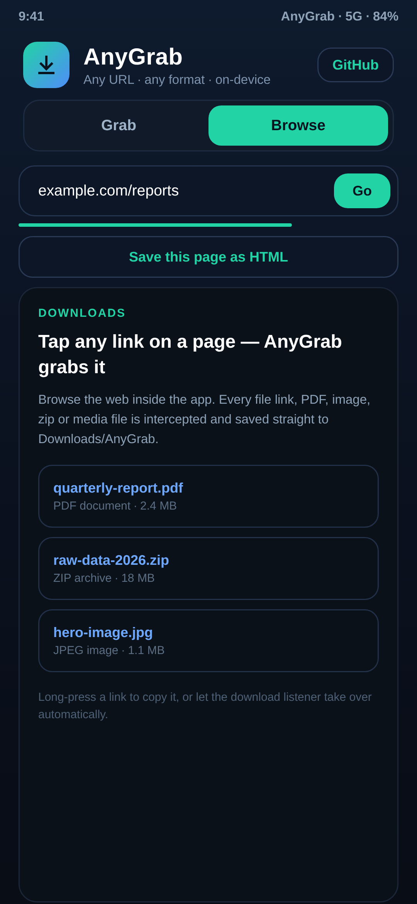

<div align="center">


# AnyGrab

**Paste any link. Save it as a file, an image, audio, video or an HTML page.**

A real, working Android app — built and signed with the Android SDK, no cloud, no account, no tracking.

[**⬇ Download the APK**](https://github.com/technicalnihilist-lgtm/anygrab/releases/latest) · [Report an issue](https://github.com/technicalnihilist-lgtm/anygrab/issues)

</div>

---

## Screenshots

| Grab | Any format | Browse + save page |
|:---:|:---:|:---:|
|  |  |  |
| Paste a link, hit download | Original / JPG / PNG / WEBP / Audio / Video / HTML | Tap any file link, or save the whole page |

## What's new in 1.1.0

- **Audio** — pulls the sound track out of a downloaded video into a clean `.m4a` (AAC) or `.webm` (Opus/Vorbis) file.
- **Video** — re-packs the movie into `.mp4` / `.webm` with **no re-encoding and no quality loss** (lossless remux).
- **HTML** — builds a small dark-mode viewer page next to any downloaded file: images show inline, video and audio get a player, PDFs open in a frame, everything else gets a download button.
- **Save this page as HTML** — a new button in Browse that captures the page you are looking at (full DOM) into a single `.html` file.

## What it does

- **Any URL in.** `https://…/file.pdf`, an image CDN link, a zip, an APK, a podcast mp3, a video file — paste it and it downloads.
- **Smarter than a browser.** The app does a lightweight ranged request, follows redirects, reads `Content-Disposition` and `Content-Type`, and works out the correct file name and extension even when the URL has none (e.g. `…/download?id=42`).
- **Seven output formats.** Keep the file exactly as served, re-encode images, extract audio, remux video, or wrap it in HTML — all on-device.
- **Browse mode.** A built-in WebView with a download listener: any file link you tap is grabbed. A **Save this page as HTML** button captures the current page.
- **Share-to-grab.** Share a link from any app — AnyGrab appears in the share sheet and prefills the URL.
- **Real downloads.** Uses the system `DownloadManager`: background downloads, progress, resume, notification on completion, files land in `Downloads/AnyGrab/`.
- **Open, share, retry.** Tap a finished item to open it, long-press to share, retry failed ones.

No analytics, no server of ours, no login.

## Output formats

| Choice | What you get | How |
|---|---|---|
| **Original** | The file exactly as the server sends it | `DownloadManager` |
| **JPG / PNG / WEBP** | Re-encoded image | `BitmapFactory` + `Bitmap.compress` |
| **Audio** | `.m4a` (AAC) or `.webm` (Opus/Vorbis) | `MediaExtractor` → `MediaMuxer`, no re-encode |
| **Video** | `.mp4` or `.webm` | `MediaExtractor` → `MediaMuxer`, lossless remux |
| **HTML** | A viewer page next to the file | Generated locally, zero network |

## Install

1. Download `AnyGrab-1.1.0.apk` from the [releases page](https://github.com/technicalnihilist-lgtm/anygrab/releases/latest).
2. Allow *Install unknown apps* for your browser or file manager when prompted.
3. Install and open. Files are saved to `Downloads/AnyGrab/`.

Upgrading from 1.0.0? Just install over it — same signing key, data and downloads stay.

**Requires Android 5.0 (API 21) or newer.** Targets Android 15 (API 35).

## How it works

| Piece | Job |
|---|---|
| `MainActivity` | Tabs, URL field, format chips, download list, browse WebView, page capture |
| `Net` | Ranged GET probe → follows redirects, parses `Content-Disposition` / `Content-Type`, guesses name, extension and size |
| `DownloadManager` | The actual transfer — system-managed, resumable, with notifications |
| `ImageConvert` + `Api29` | On-device image re-encode, published into `Downloads/AnyGrab` via MediaStore on Android 10+ |
| `MediaConvert` | Audio extraction and video remux through `MediaExtractor` + `MediaMuxer` |
| `HtmlWrap` | Generates viewer pages and captures browsed pages |
| `DownloadsAdapter` | Live list with progress, status and error reasons |

The app is **framework-only** — no AndroidX, no Gradle, no third-party libraries. It compiles to a ~74 KB APK.

## Build it yourself

You need JDK 17, Android SDK platform 35 and build-tools 34.0.0.

```bash
export ANDROID_SDK_ROOT=/path/to/android-sdk
./build.sh
```

`build.sh` runs the real toolchain directly: `aapt2 compile` → `aapt2 link` → `javac` → `d8` → `zipalign` → `apksigner`. It generates a local `keystore.jks` on first run and writes `AnyGrab-1.1.0.apk`.

## Known limits (honest ones)

- **It downloads what a server actually serves.** A page that only exposes a player (YouTube and similar streaming sites, anything DRM-protected) does not hand out a file, so there is nothing to grab. Doing that needs a server-side extractor, not an on-device app.
- **Audio output is `.m4a` / `.webm`, not `.mp3`.** Android has no built-in MP3 encoder; producing MP3 would mean shipping a full encoder library. The extracted track is the original audio stream, untouched in quality.
- **Remux, not transcode.** Video keeps its original codec — H.264/HEVC goes to MP4, VP8/VP9/AV1 goes to WebM. Codec pairs a container cannot hold are reported instead of being silently re-encoded.
- Page capture saves the DOM as it stands — dynamic pages that need their JavaScript to look right may not render perfectly offline.

## License

MIT — see [LICENSE](LICENSE).
